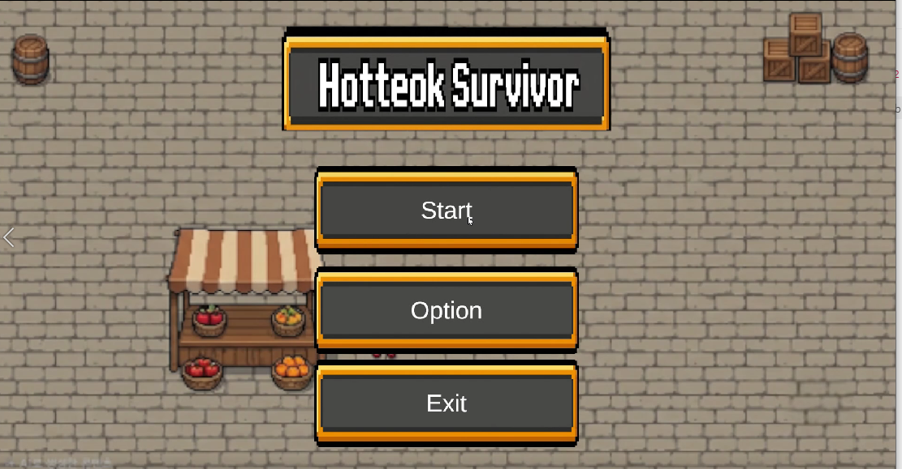

# 호떡 서바이버

> 수많은 적과 탄환을 감당하기 위해 물리 엔진 대신 공간 분할 격자로 충돌을 직접 구현



> **코드 공개용 저장소입니다.** 유료 에셋과 씬·프리팹을 빼고 직접 작성한 C# 코드만 원본 저장소에서 옮겼습니다.
> Unity에서 열어도 실행되지 않으니, 플레이 모습은 아래 시연 영상으로 봐 주세요.

## 링크

- [시연 영상](https://youtu.be/JJOqmqxmZzc) · [쇼츠](https://youtu.be/U7DGuq-M4d4)
- [프로젝트 상세 문서](https://tmdrn17.github.io/portfolio/doc.html?p=03-hotteok-survivor) — 설계 이유 · 문제 해결 · 회고
- [슬라이드](https://tmdrn17.github.io/portfolio/project.html?p=03-hotteok-survivor)
- [포트폴리오](https://tmdrn17.github.io/portfolio/)

## 개요

| 항목 | 내용 |
|---|---|
| 장르 | 2D 탑다운 서바이버 (뱀서류) |
| 기간 | 2026.06 – 07 |
| 인원 | 개인 |
| 환경 | Unity 6, C# |
| 내 역할 | 기획·개발 전체 (수업 제공 풀·싱글톤 유틸 사용) |

## 핵심 기능

| 기능 | 설명 | 코드 |
|---|---|---|
| 주변 9칸만 확인하는 공간 분할 격자 | 화면 전체가 아니라 가까운 9칸에 있는 소수의 적과만 거리를 계산합니다. | [GridManager.cs](Scripts/Manager%20And%20System/GridManager.cs) |
| 추상 클래스로 늘어나는 무기 | 레벨업 때 랜덤으로 능력을 얻거나 강화하면, 강화 레벨만큼 풀에서 호떡을 꺼내 재사용합니다. | [Hotteok.cs](Scripts/Hotteok/Hotteok.cs) |
| 끝없는 맵 | 배경 타일 9장만으로 끝없는 맵을 만들었습니다. | [MapSystem.cs](Scripts/Manager%20And%20System/MapSystem.cs) |

## 강사 제공 코드

`Course-Provided/`에는 수업에서 강사님이 제공한 유틸 중, 이 저장소의 내 코드가 쓰는 파일만 따로 두었습니다. 직접 작성한 코드가 아닙니다.

- [ComponentPool.cs](Course-Provided/ComponentPool.cs)
- [LayerMaskExtensions.cs](Course-Provided/LayerMaskExtensions.cs)
- [SimpleInput.cs](Course-Provided/SimpleInput.cs)
- [SingletonBase.cs](Course-Provided/SingletonBase.cs)
- [TransformExtensions.cs](Course-Provided/TransformExtensions.cs)

## 강사 제공 코드

`Course-Provided/`에는 수업에서 강사님이 제공한 유틸 중, 이 저장소의 내 코드가 쓰는 파일만 따로 두었습니다. 직접 작성한 코드가 아닙니다.

- [ComponentPool.cs](Course-Provided/ComponentPool.cs)
- [LayerMaskExtensions.cs](Course-Provided/LayerMaskExtensions.cs)
- [SimpleInput.cs](Course-Provided/SimpleInput.cs)
- [SingletonBase.cs](Course-Provided/SingletonBase.cs)
- [TransformExtensions.cs](Course-Provided/TransformExtensions.cs)

## 폴더 구조

```
Course-Provided/
├── ComponentPool.cs
├── LayerMaskExtensions.cs
├── SimpleInput.cs
├── SingletonBase.cs
└── TransformExtensions.cs
Scripts/
├── EnemyBullet.cs
├── Entity/  (6)
├── Hotteok/  (5)
├── Manager And System/  (7)
└── Money.cs
images/
```

괄호 안은 파일 수입니다.

## 사용 라이브러리 · 에셋

저장소에 넣지 않았습니다.

- 없음 (수업에서 제공한 유틸은 `Course-Provided/`에 따로 둠)
